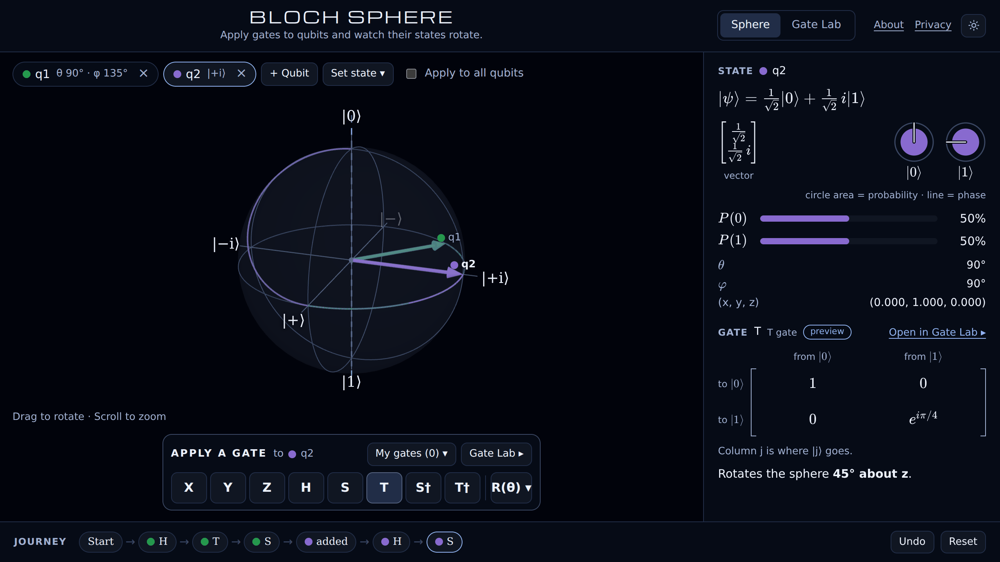

# Bloch Sphere

An interactive Bloch sphere for students meeting quantum computing for the first time. Apply gates to qubits and watch their states rotate, see every state and gate as exact numbers, and build your own gates in the Gate Lab.



## What you can do

- **Apply gates and watch them turn the sphere.** X, Y, Z, H, S, T, S†, T†, and rotations about x, y or z by any angle. Point at a gate to preview where it takes the qubit before you click.
- **Up to five qubits,** each with its own color and arrow. Apply a gate to one of them or to all at once.
- **See the state in several ways:** the ket with exact values (1/√2, e^{iπ/4}), the state vector, circle notation, measurement probabilities, and the angles θ and φ.
- **See the gate as a matrix and as a rotation:** "Rotates the sphere 45° about z."
- **Replay the journey.** Every gate is a step: click a step to replay to it, undo the last one, or reset.
- **Build gates in the Gate Lab.** Combine gates and see the single rotation they add up to (H·T·H is 45° about x), undo them (U†), repeat them, take fractions (√X), and check whether order matters. Save your gates and use them on the sphere.

It's made for desktop browsers, in light or dark: it follows your system until you switch with the theme button in the top bar. Keyboard: X, Y, Z, H, S, T apply gates (Shift+S and Shift+T for S† and T†), 1–5 select a qubit, A applies to all, Ctrl+Z undoes.

Your work stays in your browser. There are no accounts, cookies, analytics or third-party requests; see the [privacy page](web/public/privacy.html). Questions or ideas: open an issue, or write to ferasbish@gmail.com.

## Running it locally

You need [Node.js](https://nodejs.org/) 24 (the version is in `.nvmrc`).

```sh
cd web
npm install
npm run dev     # http://localhost:5173
npm test        # unit tests (Vitest)
npm run build   # type-check and build into web/dist
```

## How it's built

TypeScript, React 19, three.js through React Three Fiber and drei, Zustand for state, KaTeX for the math, built with Vite and tested with Vitest. It's a static site with no backend.

```
web/src/
├── math/      complex numbers, qubits, gates, vectors
├── model/     the journey (Sphere) and the Gate Lab's bench, as plain TypeScript
├── format/    exact values, angles and captions as text and LaTeX
├── persist/   browser storage, validated on load
└── ui/        React: the two rooms, the 3D scene, panels and widgets
```

The design, including why things are the way they are, is in [`docs/design.md`](docs/design.md) and [`docs/design-gates.md`](docs/design-gates.md).

### Python reference

[`python/`](python) holds the same qubit and gate math in NumPy, with its own tests. It's the reference the TypeScript is checked against.

```sh
python -m venv .venv
.venv/bin/pip install -r requirements.txt
.venv/bin/python -m pytest
```

## Deploying

The site deploys to GitHub Pages with [`.github/workflows/deploy.yml`](.github/workflows/deploy.yml). Setting it up, including a custom domain, is described in [`docs/deploying.md`](docs/deploying.md).

## Branches

- `main`: the site.
- `circuit-lab`: an unfinished circuit builder (two-qubit gates, entanglement, measurement), parked to become its own project.

## License

[MIT](LICENSE)
